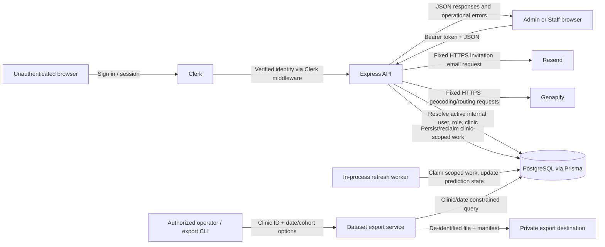

# Pravaah v0.5 Threat Model

**Baseline:** `add66870635961386c29bb0eb3e3e286900c2eed` (`main`, root package `0.4.0`)  
**Method:** Repository-derived assets, trust boundaries, data-flow tracing and STRIDE. Deployment assumptions are marked unverified.

## System context and data flow

The diagram reflects repository evidence. Actual network segmentation, provider restrictions, log destination, database privileges, hosting controls, and export recipient/storage controls are not visible here.

## Security assets

| Asset | Why it matters | Primary controls observed / uncertainty |
|---|---|---|
| Patient identity/contact: name, phone, email, gender, DOB/age | Directly identifies clinic clientele | Clinic scope and Zod; list projections are broad and unbounded (SEC-F-01). |
| Patient address, coordinates, emergency contacts | Physical location and sensitive contact data | Clinic authorization; outbound Geoapify requests; provider data handling/key policy unknown. |
| Patient-clinic relationship, clinic notes, visit counters/history | Separates context and care relationship per clinic | PatientClinic ownership checks; schema permits global Patient and multiple links. |
| Doctor identity/contact/registration and availability | Staff privacy and clinic operations | DoctorClinic link checks; global Doctor profile can be shared if links exist. |
| Appointment, schedule, attendance, queue and activity history | Patient workflow integrity and operational privacy | Clinic owner checks, validated state transitions, transaction/consistency tests. |
| No-show prediction, reason and feature snapshot | Sensitive inference and model explainability | Clinic scope; latest prediction included in appointment detail response. |
| Internal user role/status, clinic ownership and configuration | Defines authorization boundary | Clerk identity plus active internal-user and server-side role/clinic checks. |
| Staff invitation token and invitation metadata | Token grants a path to clinic membership | Random token, hash-at-rest, expiry, one-time state and authenticated-email binding. |
| Clerk session/token and deployment secrets | Authenticates identity and provider/database connections | Clerk integration and env config; production settings and secret store unverified. |
| PostgreSQL records, credentials, privileges and backups | Source of patient and operational data | Prisma access reviewed; production role/RLS, encryption, retention and recovery unavailable. |
| Logs and error events | Can reveal PHI, tokens, addresses or internals | Most handled errors are controlled; unknown errors are logged. Access/redaction/retention unverified. |
| Dataset exports and manifests | Reusable sensitive analysis artifact | De-identification, cohort rules, clinic/date constraints, file mode 0600, no-overwrite and gitignore observed; destination governance unknown. |
| Background refresh work and prediction state | Can alter derived data or affect availability | In-process worker claims/reclaims scoped jobs and updates clinic/patient-linked prediction state. |

## Actors and assumptions

| Actor | Capability and motivation | Security expectation |
|---|---|---|
| Unauthenticated internet user | Probe public health/root or protected routes | Protected endpoints deny access; public output stays minimal. |
| Authenticated Admin | Manage clinic, staff, records and workflows | Confined to own clinic; Admin-only actions enforced by backend. |
| Authenticated Staff | Perform clinic workflow and view records | Confined to own clinic; cannot administer staff or protected lifecycle resources. |
| Compromised staff/Admin session | Valid bearer token and legitimate role | Limit bulk extraction, request volume and session lifetime; MFA/session controls partly reside in Clerk. |
| Malicious or mistaken clinic operator | Legitimate account; may misuse broad views or exports | Minimize returned data, maintain scoped access, audit sensitive actions and govern exports. |
| External provider (Geoapify/Resend) | Receives submitted address/routing or invite data | Fixed HTTPS egress, minimal data, bounded timeouts, restricted keys and contractual controls. |
| Database/hosting administrator | Infrastructure-level access | Least privilege, protected backups/secrets and audited administration; config not inspected. |
| Unauthorized clinic user | Account in Clinic A seeks Clinic B records | Deny direct and nested cross-tenant reads/writes. |
| Authorized export operator | Runs offline export with configuration/filesystem access | Export only approved clinic/window/cohort and protect output. |

Assume production TLS is provided by hosting, but verify it. Repository defaults are not proof of deployed configuration. No production identity or data was used.

## Trust boundaries

| Boundary | Data crossing / untrusted input | Authentication and authorization | Existing controls | Failure mode and evidence |
|---|---|---|---|---|
| Browser ↔ protected frontend/API | Form fields, query strings, IDs, bearer token, JSON responses | Clerk session in frontend; API repeats identity/internal-user checks | API client attaches Authorization; backend Zod and role/clinic checks; CORS allowlist in app | Token theft, excess response exposure, permissive origin/browser policy. Source verified; deployed origins/headers not. |
| Clerk ↔ Pravaah identity | Clerk user ID and auth state | Clerk verifies identity; app maps to active internal User, role and clinic | Clerk middleware, authenticateRequest, authService; separate onboarding/invitation identity routes | Mismatch, stale/suspended account, weak MFA/session policy. Code checked; Clerk settings unavailable. |
| Admin ↔ Staff privileges | Admin operations, invitation lifecycle, role/status fields | Backend Admin middleware and service constraints | requireAdminRole, clinic check, schemas, scoped repositories | Frontend-only policy regression or role escalation. No server bypass found. |
| Clinic A ↔ Clinic B | URL clinic IDs and patient/doctor/appointment/queue/user/prediction IDs | Exact clinic equality and object ownership | Middleware and service ownership checks; auth/service tests | BOLA if nested relation escapes scope. No bypass found statically; deployed two-clinic test remains. |
| Express ↔ PostgreSQL | Validated fields, IDs, query parameters, raw SQL params | App authorization before DB access; DB credentials trusted | Prisma bound queries, scoped where clauses, transactions | Injection, unscoped query, overprivileged role, exposed/poorly retained backup. Static review only. |
| Express ↔ Geoapify | Clinic/patient address and coordinates; provider response | Server-side API key; restrictions unknown | Fixed HTTPS endpoint, timeout, response validation, no client-selected URL | Address disclosure, key abuse, provider outage. No SSRF path observed. |
| Express ↔ Resend | Invitee email and invitation URL/token | Server-side API credential; Admin/clinic checks | Fixed endpoint, timeout, hash-stored token; controlled errors | Email abuse, raw token in mail/log/history, provider account compromise. Logs/provider settings unknown. |
| API ↔ refresh worker | Clinic/patient work IDs and refresh state | Internal DB state; worker runs in server process | Scoped claims, leases/retries and constrained update path | Duplicate/stale work or retry pressure; unit tests passed, production load unknown. |
| Runtime ↔ secrets | Clerk, DB, Geoapify, Resend config | Hosting secret store expected | .env* ignored except examples; no actual env files read | Secret exposure, key mix-up, weak rotation or broad scope. Runtime config unavailable. |
| Export tool ↔ recipients | Clinic ID, date interval, cohort, deidentified records | Operator sets authorized-clinic env; local OS access trusted | Exact clinic constraint, window/cohort rules, de-id, file mode 0600, no overwrite | Misconfiguration or destination/recipient/retention leak. No export run. |
| Development/test ↔ production | Scripts, seeds, migrations, release artifacts | Environment configuration and operator authorization | Seed guards inspect NODE_ENV, target allowlist, database target and explicit phrase | Wrong target could modify real data; safeguards reviewed, production controls not accessed. |

## STRIDE threat matrix

| STRIDE | Threat scenario | Surface | Existing mitigation/evidence | Residual risk and response |
|---|---|---|---|---|
| Spoofing | No/invalid/revoked token or suspended user calls API | Auth middleware and Clerk | Bearer format, Clerk identity, active internal-user lookup; inactive status denied | Verify Clerk expiry/revocation and production MFA/session policy; execute invalid/expired/suspended tests. |
| Spoofing | Invitation URL/token stolen or accepted by different identity | Invite preview/accept | Random raw token, hash storage, expiry/status, email binding, one-time transaction | Verify tokens aren't logged/referrer-exposed; add rate limits. No token value inspected. |
| Tampering | Staff submits another clinic's object ID or role/status fields | ID and admin mutations | Role/clinic middleware, ownership lookups, strict schemas, state rules | Add two-clinic tests for nested appointment/patient/doctor and queue relations. |
| Tampering | Race corrupts queue/appointment/invitation state | Lifecycle, reorder/status, acceptance | Transactional lifecycle, transition allowlists, set validation, invitation row locking | Run concurrent integration tests on dedicated DB; current verification is mocked/unit level. |
| Repudiation | Sensitive action/data access cannot be attributed | API/infrastructure logs | Appointment activity history; operational logs exist | Logging policy/access/retention not observable. Define events for exports, staff changes, patient access and auth anomalies. |
| Information disclosure | Clinic account retrieves all patient/appointment rows in one response | Patient and appointment collections | Clinic and Staff+ checks prevent cross-clinic access | Unbounded list and sensitive projections confirmed. SEC-F-01: page/projection bounds and tests. |
| Information disclosure | Errors/logs/export/provider output exposes PHI, token or secrets | Error handler, providers, export destination | Known errors controlled; export de-id and file permissions; no secrets read | Verify production log redaction/access, provider restrictions, export destination/recipient policy. No proven leak. |
| Denial of service | User/bot floods lists, geocoding, onboarding or invitations | API/provider calls | Provider timeouts; invitation-specific business guard | No general HTTP limiter; unbounded list amplifies DB/memory load. SEC-F-01 and SEC-H-01. |
| Denial of service | Refresh backlog/retries consume DB or CPU | Prediction worker | Leases/reclaim limits and clinic-scoped processing; tests passed | Queue volume/metrics/retry alerting unknown; load testing only in isolated environment. |
| Elevation of privilege | Staff invokes Admin route or alters role | Clinic/staff routes, onboarding | Server Admin middleware; role stored internally; guarded onboarding/invite transactions | Verify external Clerk claims aren't treated as app role. No bypass found. |
| Elevation of privilege | Clinic A user changes ID to retrieve Clinic B data | Tenant routes | verifyClinicAccess, relationship checks and scoped repositories | Static path coverage is strong; run complete negative integration suite against release candidate. |

## Abuse cases and safe validation

1. **Cross-clinic ID substitution:** In an isolated fixture, Clinic A Staff uses Clinic B patient, doctor, appointment, queue, prediction and staff IDs. Expect 403/404 with no mutation or sensitive response difference.
2. **Sensitive collection scrape:** Clinic A Staff requests patient and appointment collections with no filters and malformed/oversized filters. Current source can return full clinic sets. After remediation, expect bounded page sizes.
3. **Role escalation:** Staff calls Admin-only routes and submits role/status fields where schemas disallow them. Expect denial/schema rejection and no row changes.
4. **Invitation misuse:** Expired, revoked, already accepted, wrong-email, invalid and concurrent accept/revoke. Expect no activation except for one valid matching invitation.
5. **Workflow race:** Concurrent same-slot booking, invalid transitions, incomplete/foreign queue reorder sets. Expect consistent state and no cross-clinic changes.
6. **Provider misuse:** Invalid address and timeout/error. Confirm only fixed HTTPS hosts are called, work is bounded, and errors don't disclose credentials or patient details.
7. **Export scope:** Fictional two-clinic exports with wrong authorized clinic, invalid date, cohort bounds, existing path and interrupted write. Expect refusal/rollback and no cross-clinic rows.

Use fictional records and authorized isolated infrastructure only. Detailed cases are in V0_5_SECURITY_TEST_PLAN.md.

## Threat priorities and residual risk

1. Limit authenticated bulk access and resource amplification on patient/appointment collection routes (SEC-F-01).
2. Set general request rate policies for sensitive and provider-triggering routes (SEC-H-01).
3. Verify production auth, CORS, headers, secrets, DB privilege, backup, logging, provider key and build artifact controls (SEC-H-02/03/04).
4. Preserve ownership and transaction guarantees with complete two-clinic integration tests.

The largest tenant-isolation residual risk is confidence, not an identified broken check: a live two-clinic suite was unavailable. The largest source-level sensitive-data risk is broad clinic-local lists without pagination. The largest operational blind spots are infrastructure configuration, production observability and downstream handling of exports/provider data.
