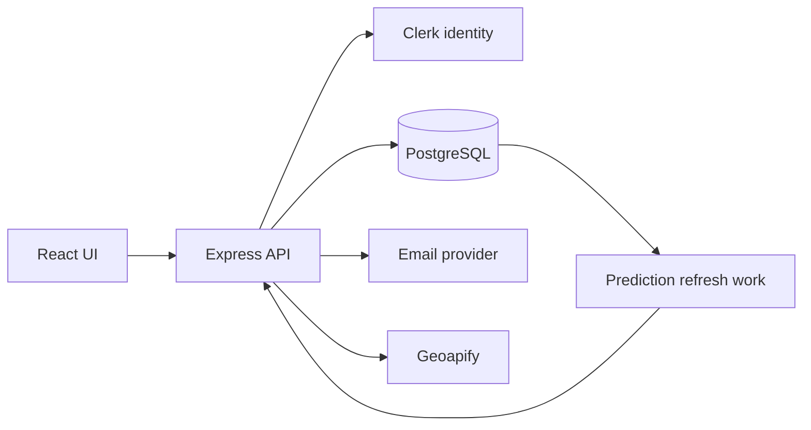

# System design challenges

Purpose: interview practice. Baseline `9e0714ef0952f6425c308faebe3ce870a1844182`; verified 2026-11-20. Status: `VERIFIED_FROM_CODE` for current behavior, `PLANNED` for design proposals.

For each design: clarify users and load; define clinic-scoped invariants; sketch API and tables; choose consistency; name failure and observability; separate current code from future additions.

| Challenge             | Current anchor                                            | Design extension to discuss                            |
| --------------------- | --------------------------------------------------------- | ------------------------------------------------------ |
| Booking service       | `appointment.repository.ts` transaction and schedule lock | idempotency keys, capacity metrics                     |
| Live queue            | `queue.repository.ts` scope lock                          | event stream with sequence numbers and reconnect       |
| Multi-clinic SaaS     | `auth.middleware.ts`, User.clinicId                       | membership table and active clinic context             |
| Staff invitation      | `staff.service.ts`, email service                         | delivery retries and provider reconciliation           |
| Prediction pipeline   | `prediction.service.ts`                                   | calibrated model with holdout data and fairness review |
| Refresh worker        | `prediction.recalculation.service.ts`                     | lease/ack observability and dead-letter operations     |
| Audit logging         | `LifecycleEvent`, `AppointmentActivity`                   | immutable export and retention policy                  |
| Patient notifications | no current automation                                     | consent, template, deduplication and opt-out           |
| Legacy integration    | no current integration                                    | import mapping, outbox, conflict resolution            |
| Large clinic network  | current monolith                                          | measure hot indexes, lock wait, and regional needs     |

The diagram represents code boundaries, not a claim that every provider call succeeds or that refresh runs in a separate service. Start every discussion by measuring current query and lock behavior before introducing a new component.
